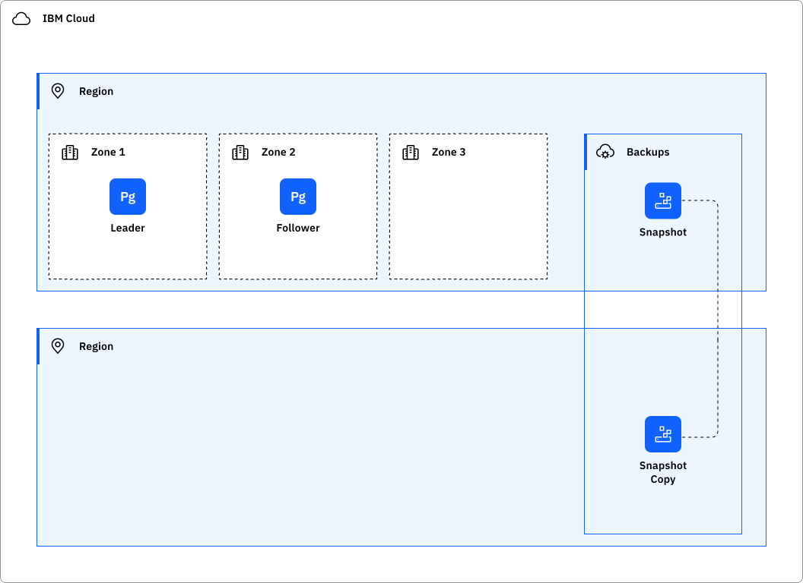
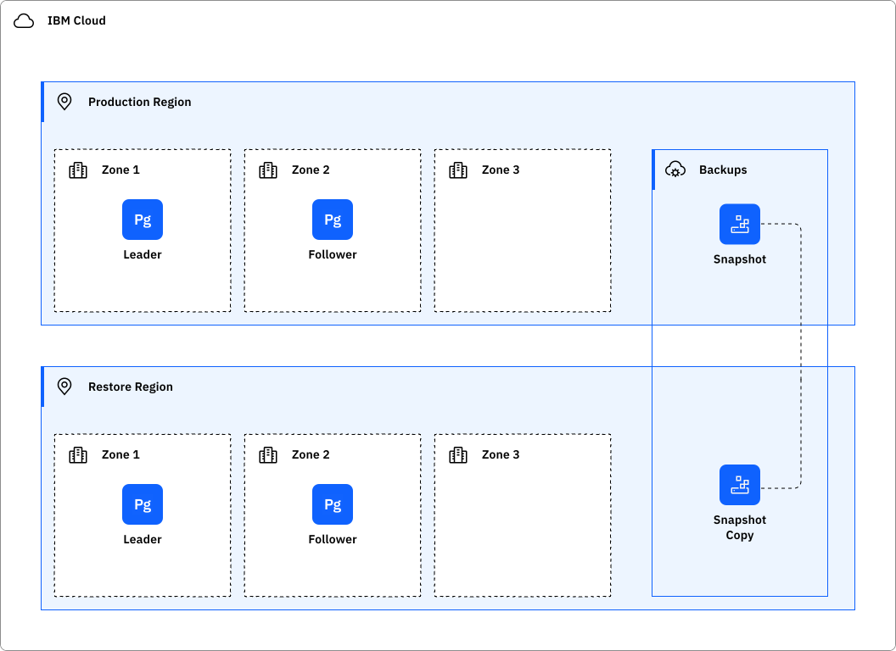

---

copyright:
  years: 2026
lastupdated: "2026-10-15"

keywords: HA, DR, high availability, disaster recovery, disaster recovery plan, disaster event, postgresql, single-zone, multi-zone
subcollection: databases-for-postgresql-gen2

---

{{site.data.keyword.attribute-definition-list}}

# Understanding high availability and disaster recovery for {{site.data.keyword.databases-for-postgresql}}
{: #postgresql-ha-dr}

[Gen 2]{: tag-purple}

[High availability](#x2284708){: term} (HA) is the ability for a service to remain operational and accessible in the presence of unexpected failures. [Disaster recovery](#x2113280){: term} is the process of recovering the service instance to a working state.
{: shortdesc}

{{site.data.keyword.databases-for-postgresql}} is a regional service that fulfills the defined [Service Level Objectives (SLO)](/docs/resiliency?topic=resiliency-slo) with the Standard plan. For more information, see [Service Level Agreement (SLA)](https://www.ibm.com/support/customer/csol/terms/?id=i126-9268&lc=en). For more information about the available {{site.data.keyword.cloud_notm}} regions and data centers for {{site.data.keyword.databases-for-postgresql}}, see [Service and infrastructure availability by location](/docs/overview?topic=overview-services_region).

## Deployment models
{: #deployment-models}

{{site.data.keyword.databases-for-postgresql}} supports both single-zone and multi-zone deployments.

Multi-zone deployments are the default and recommended option for production workloads. Database members are distributed across multiple availability zones within a region, providing protection from zone failures and automatic failover capabilities.

Single-zone deployments place all database resources within a single availability zone. While single-zone deployments can reduce cost and infrastructure requirements, they do not provide protection from availability zone outages. If the selected zone becomes unavailable, the deployment becomes unavailable until the zone recovers.

The selected availability zone for a single-zone deployment cannot be changed after provisioning. Single-zone deployments can be upgraded to multi-zone deployments, but Multi-zone deployments cannot be converted to single-zone deployments. For production workloads with availability requirements, IBM recommends multi-zone deployments.

| Deployment model | Zones used | Protection from zone failure | Automatic cross-zone failover |
|------------------|------------|------------------------------|-------------------------------|
| Single-zone | One | No | No |
| Multi-zone (default) | Multiple | Yes | Yes |
{: caption="Deployment model comparison" caption-side="top"}

The Tier 3 SLA applies only when a high-availability configuration is selected. Single-zone deployments carry a reduced SLA of 99.9% due to the absence of cross-zone redundancy. See [Service Level Agreement (SLA)](https://www.ibm.com/support/customer/csol/terms/?id=i126-9268&lc=en).
{: .note}

## Available architecture
{: #availability-architecture}

### Single-zone deployments
{: #singlezone-architecture}

Single-zone deployments place all database resources within a single availability zone.

Single-zone deployments provide a lower-cost deployment option but do not provide protection from availability zone failures. If the selected availability zone experiences an outage, the deployment becomes unavailable until the zone recovers.

Because all resources are located within a single zone, automatic cross-zone failover is not available. Maintenance activities, infrastructure failures, or zone outages can result in longer service interruptions than multi-zone deployments.

Single-Zone deployments are recommended for:

* Development and test environments
* Non-production workloads
* Applications that can tolerate downtime during infrastructure or zone events
* Cost-sensitive workloads that do not require high availability

For production workloads requiring high availability, IBM recommends multi-zone deployments.

### High availability architecture
{: #ha-architecture}

{: caption="PostgreSQL architecture" caption-side="bottom"}

{{site.data.keyword.databases-for-postgresql}} multi-zone deployments provide replication, failover, and high-availability features to protect your databases and data from infrastructure maintenance, upgrades, and failures. Multi-zone deployments distribute database members across availability zones within a region and are the recommended architecture for production workloads. Deployments contain a cluster with two members: a leader and a replica. The replica is kept up to date through asynchronous replication. A distributed consensus mechanism is used to maintain cluster state and handle failovers. If the leader becomes unreachable, the cluster initiates a failover, the replica is promoted to leader, and a new replica joins the cluster. The leader and replica are always in different zones. If the replica fails, a new replica is created. If a zone failure causes a member to fail, the new replica is created in a surviving zone.

You can extend high availability further by adding [PostgreSQL members](/docs/databases-for-postgresql?topic=databases-for-postgresql-horizontal-scaling) to the cluster for greater in-region redundancy.

Review the PostgreSQL documentation on [replication techniques](https://www.postgresql.org/docs/current/wal-async-commit.html){: .external} to understand the constraints and tradeoffs that are associated with the asynchronous replication strategy that is deployed by default.

In scenarios where a database becomes critically unhealthy, such as a server crash on the leader, {{site.data.keyword.databases-for-postgresql}} attempts a failover. This automatic failover is capped at 16 MB of data lag from leader to replica and is not performed if the lag threshold is exceeded. If the potential for 16 MB of data loss is intolerable for the application, see [synchronous replication](#ha-synchronous-replication).

Workloads that programmatically access the cluster must follow the client availability retry logic to maintain availability.

The service can perform controlled failovers during normal operation. These failovers are no-data-loss events but reset active connections. For up to 15 seconds, reconnections can fail. Service maintenance, for example, triggers a controlled failover. Unplanned failovers can also occur due to unforeseen events in the operating environment. These can take up to 45 seconds, but typically complete in less than 30 seconds.

#### High availability features
{: #ha-features}

{{site.data.keyword.databases-for-postgresql}} supports the following high availability features:

| Feature | Description | Consideration |
| -------------- | -------------- | -------------- |
| Automatic failover | Standard on multi-zone clusters. Provides resiliency against a zone or single-member failure. | Not available on single-zone deployments. |
| Member count | Minimum of 2 members. The default is a Standard two-member deployment. A two-member cluster automatically recovers from a single instance or zone failure (with data loss up to the lag threshold). During data synchronization for a new replica, the cluster is exposed to a second failure that could cause data loss. A three-member cluster (see [adding PostgreSQL members](/docs/databases-for-postgresql?topic=databases-for-postgresql-horizontal-scaling)) is resilient to the failure of two members during the same failure period. | Three members are required for synchronous replication. |
{: caption="High availability features" caption-side="top"}

##### Synchronous replication for {{site.data.keyword.databases-for-postgresql}}
{: #ha-synchronous-replication}

By default, streaming replication is asynchronous. If the leader crashes, some committed transactions might not have synced to the replica, causing data loss. {{site.data.keyword.databases-for}} keeps data loss to a minimum. However, synchronous replication confirms that all changes made by a transaction have been synced to a replica, which ensures consistency across a cluster. Writes are confirmed on a replica before success is returned to the client. For variables regarding synchronous replication, see [`synchronous_commit`](/docs/databases-for-postgresql?topic=databases-for-postgresql-changing-configuration#gen-settings) on the Changing Configuration page.

Synchronous replication brings replica availability into the primary write path. If no replica is available to acknowledge a write, the write hangs until a replica is available. Synchronous replication is not supported on two-member deployments and requires at least three members to function reliably. You _must_ horizontally scale to at least three members before enabling synchronous replication. See [adding PostgreSQL members](/docs/databases-for-postgresql?topic=databases-for-postgresql-horizontal-scaling).

While unlikely, more than one replica might become unavailable simultaneously. If this happens, the primary database cannot complete any writes until a replica comes back online, which blocks all write traffic to your database. When you decide to use synchronous replication, weigh the benefits of higher data durability against potential availability issues.

Configuring synchronous replication can significantly increase write latency and reduce overall throughput. For optimal performance, use synchronous replication only on specific databases or workloads that require the highest degree of data durability.
{: .note}

## Disaster recovery architecture
{: #disaster-recovery-intro}

The general strategy for disaster recovery is to create a new database, like the `Restore` database in the following diagram. The contents of the new database can be a backup of the source database created before the disaster. 

{: caption="PostgreSQL disaster recovery architecture" caption-side="bottom"}

### Disaster recovery features
{: #dr-features}

{{site.data.keyword.databases-for-postgresql}} supports the following disaster recovery features:

| Feature | Description | Consideration |
| -------------- | -------------- | -------------- |
| Backup restore | Create a database from a previously created backup. See [Managing Cloud Databases backups](/docs/cloud-databases?topic=cloud-databases-dashboard-backups). | New connection strings for the restored database must be referenced throughout the workload. |
| Point-in-time restore | Restore a database to a chosen point in time. | Not yet available for Gen 2. |
| Promote read replica | Promote a read-only replica to a read/write database for regional failure scenarios. | Not yet available for Gen 2. |
{: caption="Disaster recovery features" caption-side="top"}

### Planning for disaster recovery
{: #features-for-disaster-recovery}

Practice the disaster recovery steps regularly. As you build your plan, consider the following failure scenarios and resolutions.

| Failure | Resolution |
| -------------- | -------------- |
| Hardware failure (single point) | IBM provides a database that is resilient to a single point of hardware failure within a zone. No configuration is required. |
| Zone failure | Multi-zone deployments use [automatic failover](#ha-architecture) because database members are distributed between zones. Configuring three members provides additional resiliency to multiple zone failures.  Synchronous replication reduces RPO at the expense of performance.  Single-zone deployments are unavailable until the zone recovers. |
| Data corruption | Backup restore: use the restored database in production, or as source data to correct the corruption.  Point-in-time restore: not yet available for Gen 2. | |
| Regional failure | Backup restore: use the restored database in production.  Promote read replica: not yet available for Gen 2. | |
{: caption="Failure scenarios and resolutions" caption-side="top"}

## Application-level high availability
{: #application-level-ha}

Applications that communicate over networks and cloud services are subject to transient connection failures. Design your applications to retry connections when errors are caused by a temporary loss in connectivity to your deployment or to {{site.data.keyword.cloud_notm}}.

Because {{site.data.keyword.databases-for-postgresql}} is a managed service, regular updates and database maintenance occur as part of normal operations. This can occasionally cause short intervals where your database is unavailable. These activities can also trigger a graceful failover that requires applications to reconnect. During failover, it takes a short time for the cluster to establish the new leader and replica roles, so you might also see a short connection interruption. Unplanned failovers generally take less than 30 seconds.

Design your applications to handle temporary interruptions to the database, implement error handling for failed database commands, and implement retry logic to recover from a temporary interruption.

Several minutes of database unavailability or connection interruption are not expected. If you have periods longer than a minute with no connectivity, open a [support case](https://cloud.ibm.com/unifiedsupport/cases/add) with details so that IBM can investigate.

## Connection limits
{: #connection-limits-ha}

{{site.data.keyword.databases-for-postgresql}} sets the maximum number of connections to your PostgreSQL database to **115**. 15 connections are reserved for the superuser to maintain the state and integrity of your database, and 100 connections are available for you and your applications. After the connection limit is reached, any attempt to start a new connection results in an error. To prevent overwhelming your deployment with connections, use connection pooling or scale your deployment to increase its connection limit. For more information, see [Managing PostgreSQL connections](/docs/databases-for-postgresql-gen2?topic=databases-for-postgresql-gen2-managing-connections).

## Your responsibilities for HA and DR
{: #feature-responsibilities}

The following information can help you create and continuously practice your plan for HA and DR.

When you restore a database from backups, a new database is created with new connection strings. Adjust existing workloads and processes to use the new connection strings.

A recovered database might also need the same customer-created dependencies as the original database. Make sure that these and other services exist in the recovered region:

- {{site.data.keyword.keymanagementservicefull}}

Deleting a database also deletes its associated backups. However, deleted databases might be recoverable within a limited timeframe. For details on database recovery procedures, see the [documentation](/docs/cloud-databases?topic=cloud-databases-faq-backups).

It is not possible to copy backups off {{site.data.keyword.cloud_notm}}, so consider using database-specific tools for additional backups. You might need them to recover from malicious database deletion followed by a reclamation delete of a database. Careful management of IAM access to databases can help reduce exposure to this problem.

Use the following checklist to create and practice your plan.

- Backup restore
   - Verify that backups are available at the desired frequency to meet RPO requirements. [Managing Cloud Databases backups](/docs/cloud-databases?topic=cloud-databases-dashboard-backups) documents backup frequency. If the criticality and size of the database allow, consider a script that uses [{{site.data.keyword.cloud_notm}} Code Engine periodic timer (cron) event producer](/docs/codeengine?topic=codeengine-subscribe-cron) to create additional on-demand backups to improve RPO. 
   - Some restrictions apply to database restore regions. Verify that your restore goals can be achieved by reading [Managing Cloud Databases backups](/docs/cloud-databases?topic=cloud-databases-dashboard-backups).
   - Verify that the retention period of the backups meets your requirements.
   - Schedule test restores regularly to verify that the actual restore times meet your defined RTO. Database size significantly affects restore time. Consider strategies to minimize restore times, such as breaking down large databases into smaller, more manageable units and purging unused data.
   - Verify that the {{site.data.keyword.keymanagementservicelong_notm}} root key used to encrypt your database is available in the recovery region.

To find out more about responsibility ownership between the customer and {{site.data.keyword.cloud_notm}} for using {{site.data.keyword.databases-for-postgresql}}, see [Shared responsibilities for {{site.data.keyword.databases-for}}](/docs/cloud-databases-gen2?topic=cloud-databases-gen2-responsibilities-cloud-databases).

## Stay informed: {{site.data.keyword.IBM_notm}} notifications
{: #ibm-service-notifications}

Updates that affect customer workloads are communicated through {{site.data.keyword.cloud_notm}} notifications. To stay informed about planned maintenance, announcements, and release notes related to this service, see [Monitoring notifications and status](/docs/support?topic=support-viewing-status). In addition, regularly review the [Version policy](/docs/cloud-databases?topic=cloud-databases-versioning-policy) page for the latest updates on End-of-Life versions and dates.

## Additional guidance
{: #ha_dr-guidance}

- [Understanding high availability for Cloud Databases](/docs/cloud-databases-gen2?topic=cloud-databases-gen2-ha-dr)
- [Understanding business continuity and disaster recovery for Cloud Databases](/docs/cloud-databases-gen2?topic=cloud-databases-gen2-bc-dr)
- [Managing connections - Databases for PostgreSQL](/docs/databases-for-postgresql-gen2?topic=databases-for-postgresql-gen2-managing-connections)
